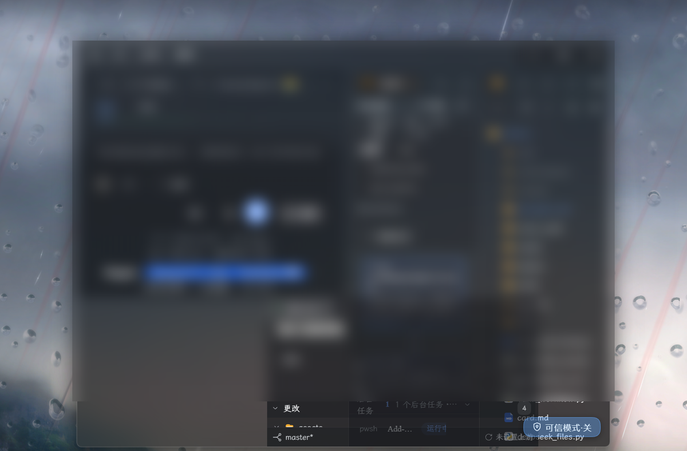

# dsh-glass-skin

Acrylic / frosted-glass appearance for [DeepSeek Harness](https://github.com/deepseek-ai): translucent surfaces that let **your desktop show through the window**, layered on top of whatever theme you already use.



```bash
npx --allow-git=all github:InkStain258/dsh-glass-skin
```

One command. It installs the plugin *and* patches the window material.

> **npm 12 and newer refuse git dependencies by default.** `npx` fails with
> `EALLOWGIT: Fetching packages of type "git" have been disabled` unless the flag
> above is passed. On older npm the flag is unnecessary and harmless.


> **Windows 11** is the fully supported platform (native acrylic). On macOS the plugin half works and uses the vibrancy the app already has. On Linux the window patch is skipped.

---

## What you get

| Layer | Effect |
| --- | --- |
| **Native window material** | the OS blurs the desktop behind the window (acrylic on Windows) |
| **Glass surfaces** | the app's own backgrounds become 70–82% transparent, keeping the active theme's colours |
| **Frosted blur** | a 30px backdrop blur so text stays readable over a busy wallpaper |

Works **together with existing theme plugins**. It does not replace your theme; it stacks on top of it. Mineradio, the official homepage theme, open-sea-skin and custom themes all keep their palette — only opacity changes.

---

## Install

### The one-liner

```bash
npx --allow-git=all github:InkStain258/dsh-glass-skin
```

Or from a clone:

```bash
git clone https://github.com/InkStain258/dsh-glass-skin.git
cd dsh-glass-skin
node scripts/install.mjs
```

**Close DeepSeek Harness first if you can.** The installer patches `app.asar`, and a running app holds a lock on it. If it is open, the installer tells you so and leaves your files untouched — just quit and re-run.

Then **restart the app**.

### Options

```bash
node scripts/install.mjs --dry-run      # show what it would do
node scripts/install.mjs --no-patch     # plugin only: translucency, no desktop show-through
node scripts/install.mjs --no-plugin    # window patch only
node scripts/install.mjs --asar <path>  # app.asar it could not find on its own
node scripts/install.mjs --uninstall    # undo everything
```

---

## Uninstall

```bash
npx --allow-git=all github:InkStain258/dsh-glass-skin --uninstall
```

Or just turn it off: **Settings → General → Glass skin**. That restores your surfaces immediately and leaves the window patch in place (the window stays blurred acrylic).

To restore the window exactly as it shipped, `--uninstall` puts back the byte-exact backup the installer made.

---

## After a DSH update

**A DSH update silently removes the window patch.** The updater replaces `resources/app.asar` wholesale, so the patched `lib/main.js` is gone — but the Client plugin in your profile is untouched. The result is a confusing half-state: surfaces stay translucent, yet the desktop no longer shows through, because nothing is asking the OS for acrylic any more.

The fix is to start the app through the launcher, which patches first and then launches:

```bash
npx --allow-git=all github:InkStain258/dsh-glass-skin launch --install
```

That writes a **DeepSeek Harness (Glass)** shortcut to your Desktop. From then on, start the app with that shortcut instead of the normal icon: it applies the patch while the app is closed, then starts it.

> **Why a launcher instead of a background repair.** The window material can only be set by patching `app.asar`, and the archive is locked while the app runs. A helper started by the app to wait for the exit does not work: it is a child of the app, so quitting takes it down before it can do anything — observed directly, the waiter logged `start` and never reached `archive released`. That is also why "quit and wait a few seconds" has no correct answer. A launcher removes the waiting instead of guessing at it.

### Or repair it now

```bash
npx --allow-git=all github:InkStain258/dsh-glass-skin repair
```

Checks whether the archive still carries the patch and does nothing if it does, so it is safe to run any time. If the app is open it stops and tells you to quit, rather than failing halfway through a 180 MB write.

### When in doubt, ask the doctor

```bash
npx --allow-git=all github:InkStain258/dsh-glass-skin doctor
```

The two halves fail differently and need different fixes, so the report keeps them apart:

```
window patch
  archive  …\resources\app.asar
  dsh      0.2.1-rc.5
  patch    missing

client plugin
  profile  …\.dsh\profiles\desktop
  installed yes (v1.4.0)
  declared  yes
  bundled   yes
  dsh meta  present

launcher
  desktop shortcut installed
```

Add `--json` for scripting, or `--fix` to apply the patch when the app is closed.

> The backup and sidecar from the previous install belong to the *old* build, so `repair` archives them under a `.stale-<sha>` name before taking a fresh one. It never restores bytes from a different release.

---

## Editing the look

Every surface value lives in one array at the top of `plugin/client.js`:

```js
const GLASS_TOKENS = [
  { name: '--dsw-alias-bg-base',            light: 30, dark: 22, … },
  { name: '--dsw-specific-sidebar-fill',    light: 26, dark: 18, … },
  …
]
```

`22` means "keep 22% of this surface's own colour", i.e. **78% of the desktop shows through**. Raise the numbers for more density and better text contrast; lower them for more glass.

The blur strength is one line in the same file:

```css
backdrop-filter: blur(30px) saturate(140%);
```

After editing, restart the app (or let HMR pick it up if you are running `dsh web` with the watcher).

---

## Why a patch is needed at all

Two layers are required, and only one of them can be a pure plugin.

The **surfaces** are a plugin: DSH lets a client plugin stack a theme-token overlay via `ctx.theme.overrideTokens()`, which is the cooperative path — the theme service composes it on every palette switch, so it survives theme changes and does not fight other themes.

The **window material** cannot be a plugin. `transparent` / `backgroundMaterial` are `BrowserWindow` constructor options evaluated when Electron creates the window, before any plugin code runs. So the installer makes one surgical, **length-preserving** edit to `lib/main.js` inside `app.asar`:

```js
// injected right after `show,`
backgroundColor:"#00000000",backgroundMaterial:"acrylic",
```

It inserts N bytes and removes exactly N bytes from an adjacent JSDoc comment, so the archive's size, header and **every entry offset stay identical**. Before replacing anything it verifies: size unchanged, header byte-identical, all entry offsets unchanged, only `lib/main.js` differs, and the extracted file still parses. If any check fails, nothing is written.

### Why not `transparent: true`?

Measured on Electron 44.7.0 / Windows 11 26300 over a high-frequency checkerboard backdrop:

| Window options | Desktop visible | Genuinely blurred | Native shadow |
| --- | --- | --- | --- |
| `backgroundMaterial:"acrylic"` | yes | **yes** | **intact** |
| `+ transparent: true` | yes | yes | **collapses to ~2px** |
| `transparent: true` only | yes | **no** — crisp, not blurred | ~2px |
| `backgroundMaterial:"mica"` | **no** | — | none |

`acrylic` alone already yields a real blurred backdrop *and* keeps the window shadow. Adding `transparent: true` costs the shadow without improving the blur. It is also the exact shape DSH's own welcome window already uses.

### Why the blur is a separate layer

`backdrop-filter` makes an element a **containing block for fixed-position descendants**. The shell's menus and dialogs are viewport-positioned, so putting the filter on the app frame would silently re-anchor every popover to that frame — and on Windows the frame is offset by the title bar, so everything would shift down.

Instead the plugin appends **one empty fixed layer at `z-index:-1`**, behind all content. It has no children, so it cannot become anyone's containing block.

---

## Compatibility

- **DSH 0.2.x** (Electron 44). The patch anchors on `createWindow()` in `lib/main.js`; if a future release moves it, the tool **refuses and reports** instead of guessing.
- **Theme plugins**: unaffected — the overlay reads colours *from* the theme registry and only changes alpha.
- **`prefers-reduced-transparency: reduce`**: the plugin turns itself off and says so in Settings instead of ignoring you.
- **Menus and popovers** stay opaque on purpose, so they remain readable.
- **An app update replaces `app.asar`** and drops the window patch. Re-run the installer; your plugin and its settings survive.

---

## Known limits

- **Windows only** for desktop show-through. macOS gets surfaces + the app's own vibrancy; Linux gets surfaces only.
- The **sidebar** keeps its own background layer, so it looks slightly less blurred than the main pane. That layer also hosts fixed-position menus, so blurring it carries positioning risk and is left opt-in.
- Acrylic's blur radius is chosen by Windows, not by the app.
- Very bright wallpapers reduce text contrast. Raise the `GLASS_TOKENS` percentages if you read long text.

---

## Development

```bash
npm test
```

Three suites, no browser needed:

| Suite | What it protects |
| --- | --- |
| `glass-client-contract.test.mjs` | loads the **real** `client.js`, runs its factory, renders the settings row with **zero props**, asserts the token overlay and the single blur layer |
| `glass-row-render.test.mjs` | the settings row in three states (on / reduced-transparency / no locale service) |
| `glass-render.test.mjs` | the theme overlay's re-entrancy guard |

Each contains a "the old shape must fail" assertion, so the tests cannot silently stop testing anything.

Two bugs these suites exist for, both found the hard way:

1. Reading `props.t` in the settings row. That slot's owner declares `children?: never` and passes nothing, so every render threw and the slot system **permanently abdicated** the entry — an empty Settings page with the error only in the console.
2. Using `ctx.get('theme')` instead of declaring `inject: ['theme']`. Under HMR the service already existed so it worked; on a cold boot the plugin activated first, got `undefined`, and silently vanished.

---

## License

[MIT](LICENSE) © dsh-glass-skin contributors

DeepSeek Harness is a separate product; this repository only adds files to your own installation and keeps a byte-exact backup of anything it touches.
